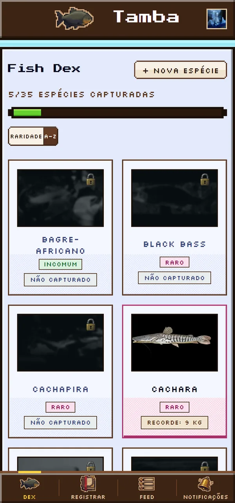
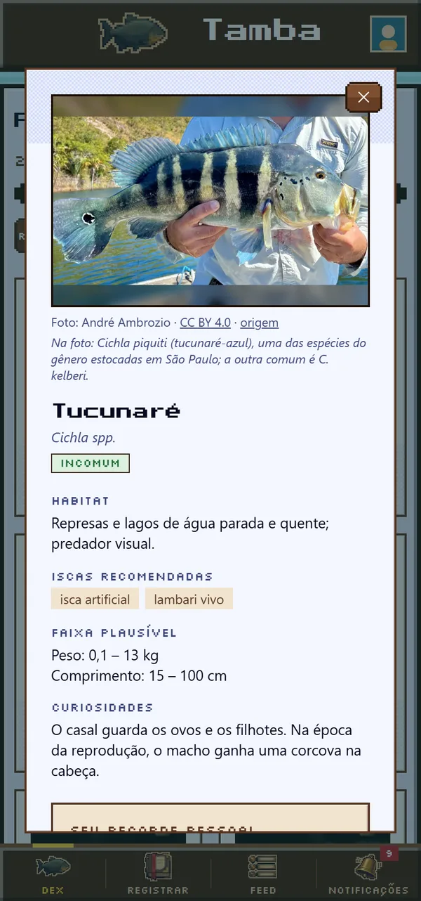

# 🎣 Tamba


O Tamba é um diário de pescarias no estilo "Pokédex de peixes": cada captura
registrada desbloqueia a espécie numa coleção pessoal, a Fish Dex, e mostra
quantas ainda faltam. Foi desenvolvido como projeto semestral no IFSP, campus
Bragança Paulista.

**Acesse:** <https://projeto-tamba.vercel.app>

O que dá para fazer:

- Registrar capturas com espécie, peso, tamanho, local e fotos
- Completar a Fish Dex, com 35 espécies de água doce, cada uma com raridade, ficha e curiosidades
- Acompanhar o recorde pessoal e as estatísticas no perfil
- Seguir outros pescadores, curtir e comentar as capturas no feed
- Receber notificações de curtidas, comentários e novos seguidores
- Instalar no celular como app (PWA)

<p align="center">
  
  &nbsp;&nbsp;
  
</p>

## Como rodar localmente

**Pré-requisitos:** Node.js 22.9 ou mais novo e MySQL 8.

```bash
git clone https://github.com/caopi/Tamba.git
cd Tamba
```

**1. Banco.** Troque a senha dentro de
[`backend/database/setup.sql`](backend/database/setup.sql) e rode o arquivo
como root, uma única vez. Ele cria o banco `tamba` e o usuário `tamba`.

```bash
mysql -u root -p < backend/database/setup.sql
```

**2. Backend.** Copie o `.env.example` e, no `.env`, ajuste a senha da
`DATABASE_URL` (a mesma do `setup.sql`) e o `JWT_SECRET`. O restante já vem
pronto para desenvolvimento.

```bash
cd backend
npm install
cp .env.example .env
npm run migrate    # cria as tabelas
npm run seed       # catálogo de espécies, pesqueiros e contas de teste
npm run dev        # API em http://localhost:3333/api
```

**3. Frontend**, em outro terminal:

```bash
cd frontend
npm install
cp .env.example .env
npm run dev        # app em http://localhost:5173
```

Abra <http://localhost:5173> e entre com `admin@tamba.local` / `admin123`, uma
das contas de teste que o seed cria.

## Documentação

- [ARQUITETURA.md](ARQUITETURA.md): estrutura do código, banco, API e convenções
- [DEPLOY.md](DEPLOY.md): deploy na Vercel e no Railway, e backups
- [CREDITOS.md](CREDITOS.md): autoria e licença das fotos do catálogo

## Equipe

- Lucas Nogueira Sanchez
- Vinicius Aparecido da Silva
- Leticia Zavazi de Almeida
- Henrique Rachid
- Fernando Henrique Camargo
- David Miqueias Santos Paixão
